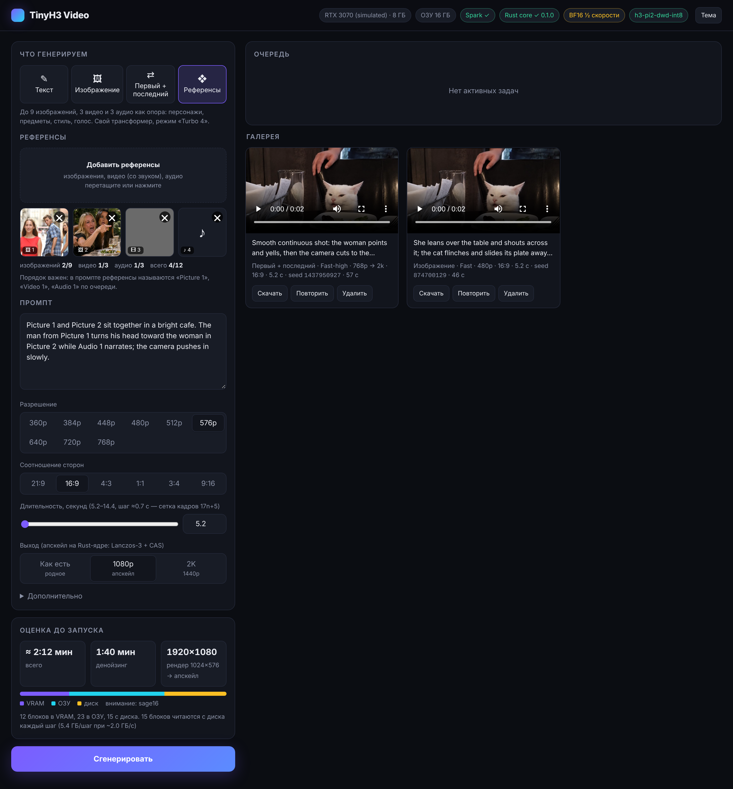
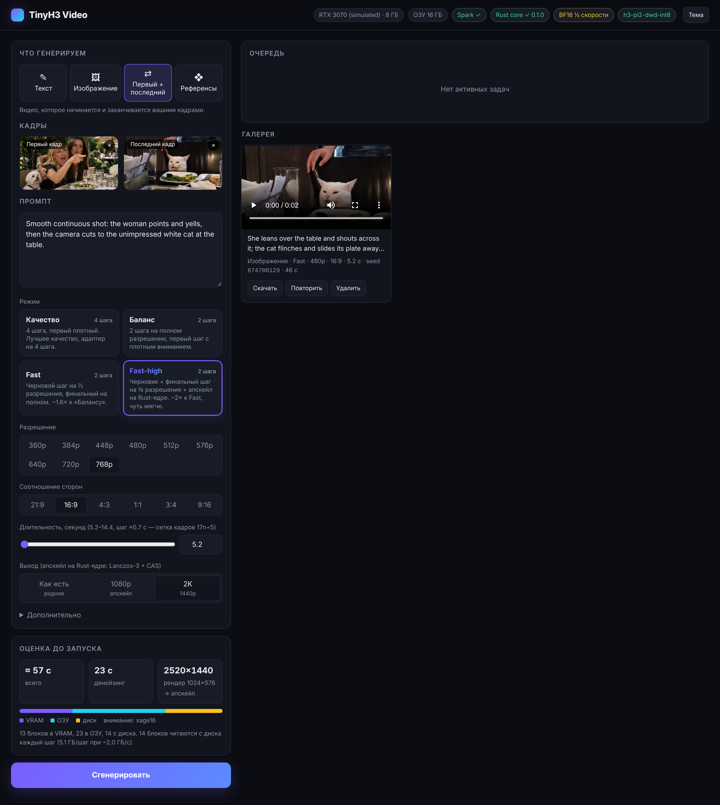

# TinyH3 Video

Генерация видео со звуком моделью **MiniMax H3** на домашней видеокарте: целевая машина —
**RTX 3070 8 ГБ + 16 ГБ ОЗУ**. Модель целиком не загружается ни в видеопамять, ни в ОЗУ: веса
блоками прокачиваются по ярусам VRAM ↔ pinned-ОЗУ ↔ диск, и эта прокачка перекрыта вычислениями.

Что внутри:

- **Четыре режима скорости**: Качество (4 шага), Баланс (2 шага), Fast (черновой проход + финальный шаг)
  и Fast-high (черновик + финальный шаг на ¾ разрешения + апскейл Rust-ядром; ~2× к Fast по денойзингу).
- **pi-Flow, 2 или 4 шага** (адаптеры [pi-H3](https://github.com/Lakonik/ComfyUI-piFlow)) вместо 8–50.
- **Rust-ядро** (`native/tinyh3-core`): параллельное чтение весов с диска в pinned-память без GIL и
  апскейл кадров до 1080p/2K (Lanczos-3 + адаптивная резкость CAS). Без него всё работает, просто медленнее.
- **DWD**: кадры предсказываются из признаков последнего шага, без VAE-декодера (−9.7 ГБ весов).
- **W8A8 ConvRot**: вращение Адамара + int8 на тензорных ядрах. На GeForce это в 4 раза быстрее bf16,
  а качество практически как у bf16. Ядра слиты: norm + AdaLN + вращение + квантование за один проход.
- **Spark-Attn**: блочно-разреженное внимание для H3 (2.2–3.1× на внимании). Если его нет —
  SageAttention с FP16-накоплением или Flash.
- **Планировщик памяти**: перед каждым запуском решает, какие блоки держать в VRAM, какие в ОЗУ и какие
  читать с диска. Учитывает реальные замеры карты, в том числе состояние [gpu-unlock](https://github.com/Zagitta/gpu-unlock).
- **Текстовый энкодер** Qwen3-VL-32B (50 слоёв) стримится послойно. Промпты кэшируются, refiner считается
  один раз на промпт, а не на каждом шаге.
- **Веб-интерфейс**: оценка времени и памяти до запуска, живой прогресс по стадиям, галерея.

Подробности: [архитектура](docs/ARCHITECTURE.md) · [исследование ускорения](docs/RESEARCH.md).

## Установка

### Установщик (Windows)

1. Скачайте репозиторий (Code → Download ZIP) и распакуйте.
2. Запустите **`install.bat`**. Установщик спросит, куда ставить: приложение, модели, текстовую башню
   (можно на другой диск), папку для видео (`?` откроет окно выбора папки); профиль размера
   (13 / ~20 / ~46 ГБ), нужны ли картинки, Ref2VA и режим «Качество». Он проверит место на каждом диске,
   подберёт PyTorch под драйвер (CUDA 12.4–12.8), скачает и сожмёт модели.
3. Запускайте **`start.bat`** из папки приложения (или ярлык на рабочем столе): он поднимет локальный сервер
   и откроет браузер на `http://127.0.0.1:7860`. Рядом лежат `console.bat` (консоль с командами `tinyh3`)
   и `uninstall.bat`.

Прервалась загрузка или ошибка — запустите `install.bat` снова: уже готовые шаги пропускаются,
остальные продолжаются. При повторном запуске в существующей установке есть меню: запустить, починить,
добавить Ref2VA / режим «Качество», перенести текстовую башню на другой диск.
Без вопросов: `install.bat --yes --app-dir D:\TinyH3 --text-dir E:\H3text --profile compact`
(все параметры: `tinyh3 install --help`). Linux / macOS: `./install.sh`, запуск — `start.sh`.

### Вручную

Python 3.10+, NVIDIA-драйвер с CUDA 12.4+ и PyTorch с CUDA.

```bash
git clone https://github.com/orcspace/tiny-h3 && cd tiny-h3
pip install -e .
pip install -e '.[sage]'        # рекомендуется: SageAttention
# Windows: pip install -e '.[windows]'   (Triton для слитых ядер)
```

**Rust-ядро** (рекомендуется; нужен [Rust](https://rustup.rs)):

```bash
pip install ./native/tinyh3-core
```

**Spark-Attn** (рекомендуется, самое большое ускорение внимания): скачайте архив релиза
[Spark-H3](https://github.com/zechengtang/Spark-H3/releases) для своей ОС и GPU (для RTX 30 — `sm86`)
и установите пакет `h3_sparse_attention` из него в то же окружение. TinyH3 найдёт его сам.

## Модель

```bash
tinyh3 setup                     # ~52 ГБ: INT8 ConvRot от Comfy-Org + адаптер pi-H3 на 2 шага → ~45 ГБ на диске
tinyh3 setup --steps 4           # второй адаптер для режима «Качество» (ещё ~45 ГБ)
tinyh3 setup --delete-sources    # удалить скачанное после конвертации
```

Конвертация идёт потензорно, ей хватает ~2 ГБ ОЗУ, а прерванный запуск продолжается с места остановки.
Есть вариант из оригинальных bf16-весов: `--source hf` (~95 ГБ).

### Мало места на диске

Обычная установка занимает ~46 ГБ (и ещё ~52 ГБ исходников на время конвертации). Если места мало:

```bash
tinyh3 setup --low-disk --dry-run      # показать, что и где займёт место, ничего не скачивая
tinyh3 setup --low-disk                # ~27 ГБ итого, исходники на диск не сохраняются
tinyh3 setup --low-disk --text-dir D:\tinyh3-text   # текстовая башня (13 ГБ) на другом диске
```

`--low-disk` читает веса с Hub по частям (range-запросы), сразу квантует и сбрасывает: временных файлов нет, пик
использует лишь несколько ГБ ОЗУ. DiT и текстовая башня при этом int4 (вращение Адамара и подбор отсечения
выбросов по группам из 128 весов). Размеры:

| Вариант | Всего | На основном диске |
|---|---|---|
| обычный (int8) | 46 ГБ | 46 ГБ |
| `--low-disk` | 27 ГБ | 27 ГБ |
| `--low-disk --text-dir <другой диск>` | 27 ГБ | **13 ГБ** (+13 ГБ на втором) |
| то же + `--no-images` (без задач с кадрами и референсами) | 25 ГБ | **12 ГБ** |

Уже установленную модель можно разгрузить задним числом: `tinyh3 move-text D:\tinyh3-text` копирует текстовую башню на
другой диск, проверяет размеры файлов и только потом удаляет оригинал; при обрыве всё остаётся на месте.

Уложиться в 10 ГБ на одном диске нельзя: один только DiT в int4 занимает 9.3 ГБ, а ещё нужны текстовая башня,
DWD-голова и аудио-VAE. Качество int4 на настоящих весах не проверено: если картинка или следование промпту
заметно хуже, возьмите `--policy mixed` (10.4 ГБ, края стека в int8) или int8 для текстовой башни (`--text int8`).
Текстовая башня читается один раз на промпт и кэшируется, поэтому на медленном втором диске (HDD) она тормозит
только первый запуск нового промпта.

Политики весов DiT (`--policy`):

| | Размер | Качество | Когда |
|---|---|---|---|
| `int8` (по умолчанию) | 18 ГБ | ≈ bf16 | NVMe/SSD: часть блоков читается с диска, но это перекрыто вычислениями |
| `mixed` | 10.4 ГБ | int8 по краям стека, int4 в середине | медленный диск, мало места |
| `int4` | 9.3 ГБ | заметно ниже без калибровки | экономия места |

## Использование

```bash
tinyh3 doctor                    # железо, ядра, состояние gpu-unlock, советы
tinyh3 serve --open              # веб-интерфейс на http://127.0.0.1:7860
tinyh3 generate "Live-action, handheld selfie video …" --seconds 8 --res 768p --mode fast-high --upscale 2k
tinyh3 plan --vram-gib 8 --ram-gib 16 --res 768p --seconds 10 --mode fast   # план и оценка без запуска
tinyh3 bench                     # замер тензорных ядер и бэкендов внимания
```

Длительность: 5.2–14.4 с при 24 кадрах/с, звук стерео 32 кГц. Разрешения генерации: от 360p до 768p,
соотношения 21:9, 16:9, 4:3, 1:1, 3:4, 9:16. Выход можно увеличить до 1080p или 2K (1440p) апскейлом
Rust-ядра. Это классический ресэмплинг с адаптивной резкостью, а не нейросетевое суперразрешение: родная
генерация в 2K на 8 ГБ заняла бы часы.

### Задачи: не только текст

| Задача | Что подаём | Как работает |
|---|---|---|
| Текст → видео | промпт | как раньше, режимы Качество / Баланс / Fast / Fast-high |
| Изображение → видео | первый кадр | кадр кодируется VAE и становится опорным (`--first`) |
| Последний кадр → видео | последний кадр | то же для конца ролика (`--last`) |
| Первый + последний | два кадра | видео, которое идёт от одного кадра к другому |
| Референсы → видео | до 9 изображений, 3 видео (со звуком), 3 аудио | отдельный трансформер Ref2VA (`--ref`), режим Turbo 4 |

```bash
tinyh3 generate "Она кричит, кот морщится…" --first frame.png --res 576p --mode fast
tinyh3 generate "Picture 1 идёт по рынку, камера как в Video 1" --ref hero.png --ref camera.mp4 --ref voice.wav
```

Подготовка запросов (подгонка кадров под канвас, ресэмплинг референсов в 24 кадра/с и в частоту аудио,
подписи `<Picture i>` / `<Video k>` / `<Audio j>` в промпте, кодирование VAE, раскладка Ref2VA) выполняется
блоками diffusers, то есть так же, как в релизном пайплайне. TinyH3 заменяет только вызов 32B-кондиционера
своим послойным энкодером, включая зрение Qwen3-VL (vision-башня, 3-осевой M-RoPE, deepstack; сверено с
transformers тестом). Референсные изображения подгоняются политикой `match` из lightx2v: те же пиксели
и пропорции, что у целевого кадра, без апскейла референса.

Установка: VAE-энкодер (0.7 ГБ) докачивается `tinyh3 setup` автоматически. Ref2VA (~27 ГБ: INT8-трансформер
Comfy-Org, LoRA Turbo 4 от lightx2v и VAE-декодер) ставится отдельно: `tinyh3 setup-ref`. У Ref2VA нет DWD-головы,
поэтому кадры декодирует VAE-декодер (4.8 ГБ fp16). На карте со свободными <12 ГБ он стримится блоками.

### Режимы

| Режим | Как работает | Денойзинг, 768p 5 с, оценка на 3070 |
|---|---|---|
| Качество | 4 шага, первый с плотным вниманием | ~160 с |
| Баланс | 2 шага на полном разрешении, первый плотный | ~80 с |
| Fast | шаг 1 на ½ разрешения (¼ токенов) → апскейл латента и повторное зашумление → шаг 2 на полном | ~46 с |
| Fast-high | то же, но шаг 2 на ¾ разрешения, кадры увеличиваются Rust-ядром | ~21 с |

Черновой проход работает, потому что после первого шага pi-H3 уровень шума ещё ~0.87: второй шаг заново
рисует все детали, а от черновика берёт композицию и движение. Fast-high платит за скорость лёгкой
мягкостью картинки, ведь финальный шаг считается при ¾ разрешения.




### gpu-unlock (Linux, по желанию)

У GeForce BF16/FP16 с FP32-накоплением ограничено половинной скоростью. Модуль ядра
[gpu-unlock](https://github.com/Zagitta/gpu-unlock) снимает это ограничение при загрузке: на 3070 внимание
ускоряется на +50–60%. TinyH3 сам ничего в системе не меняет: `tinyh3 doctor` измеряет, разблокирована ли
карта, и подбирает ядра под её состояние. Установка — пошаговый скрипт с подтверждениями, загрузчик
не трогается:

```bash
scripts/gpu-unlock-linux.sh
```

## Ожидаемая скорость на RTX 3070

Это оценки по модели производительности (`tinyh3 plan`) и замерам pi-H3 на RTX 3090. Реальные цифры
покажет `tinyh3 bench` и отчёт `<видео>.mp4.json`, где лежат тайминги стадий и пики памяти.

| Режим | 864×480, 5 с | 1024×576, 5 с | 1344×768, 5 с |
|---|---|---|---|
| Качество | ~45 с | ~71 с | ~158 с |
| Баланс | ~22 с | ~35 с | ~79 с |
| Fast | ~14 с | ~21 с | ~46 с |
| Fast-high | ~8 с | ~11 с | ~21 с |

Это денойзинг. Сверху загрузка весов (~5–7 с), DWD (5–10 с), звук и MP4.

Сверху текстовая стадия: 0 с при повторе промпта, иначе 10–45 с в зависимости от диска.

## Разработка

```bash
pip install -e '.[test]'
pytest                            # 39 тестов (+ `cargo test` в native/tinyh3-core), CPU: ядра (Triton-интерпретатор), сверка с diffusers/transformers/LakonLab
```

`python scripts/ui_demo.py` поднимает интерфейс без GPU и модели: симулированная 3070 и имитация генерации.

Папки `FreeVideo/` и `pi-H3/` — снимки исходных проектов, на которые опирался дизайн. Тесты DWD-головы
используют `pi-H3/lakonlab` как эталон.

## Лицензии

Код TinyH3 распространяется по Apache-2.0. Веса MiniMax H3 и адаптеры pi-H3 подпадают под
[MiniMax H3 Community License](https://huggingface.co/MiniMaxAI/MiniMax-H3), где есть территориальные
ограничения и ограничения на использование. Spark-H3 — Apache-2.0, gpu-unlock — GPL-2.0 (ставится отдельно, не входит в TinyH3).
